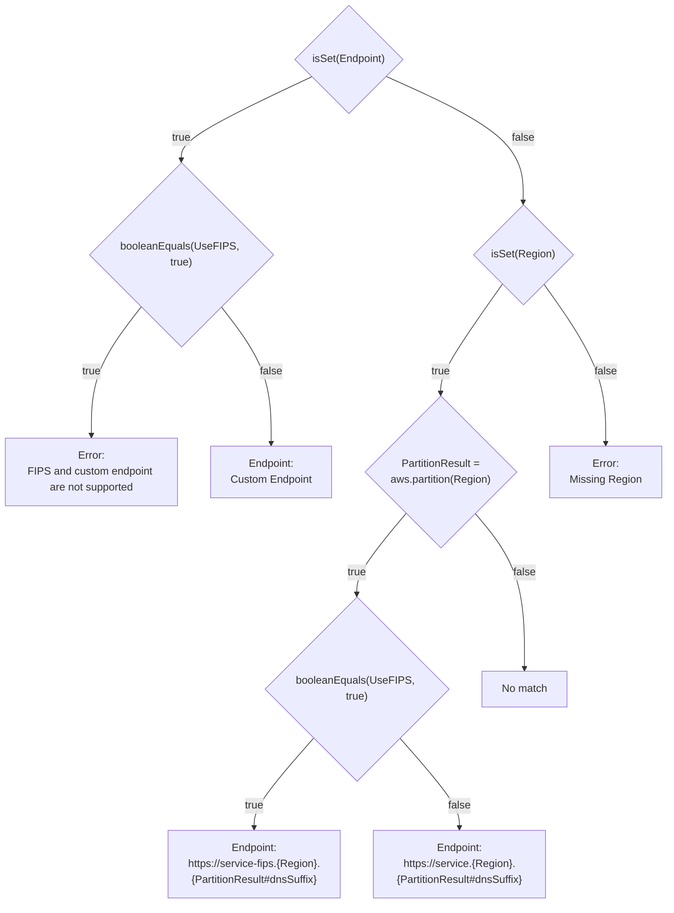
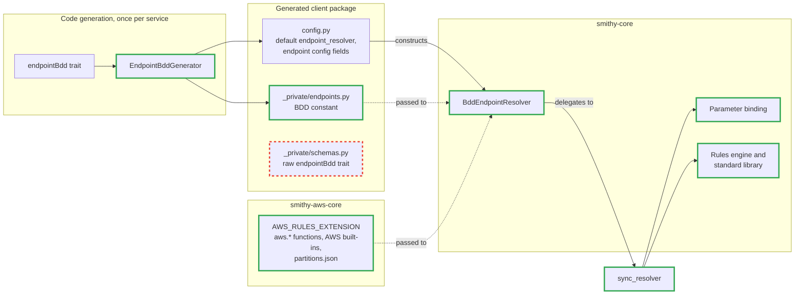
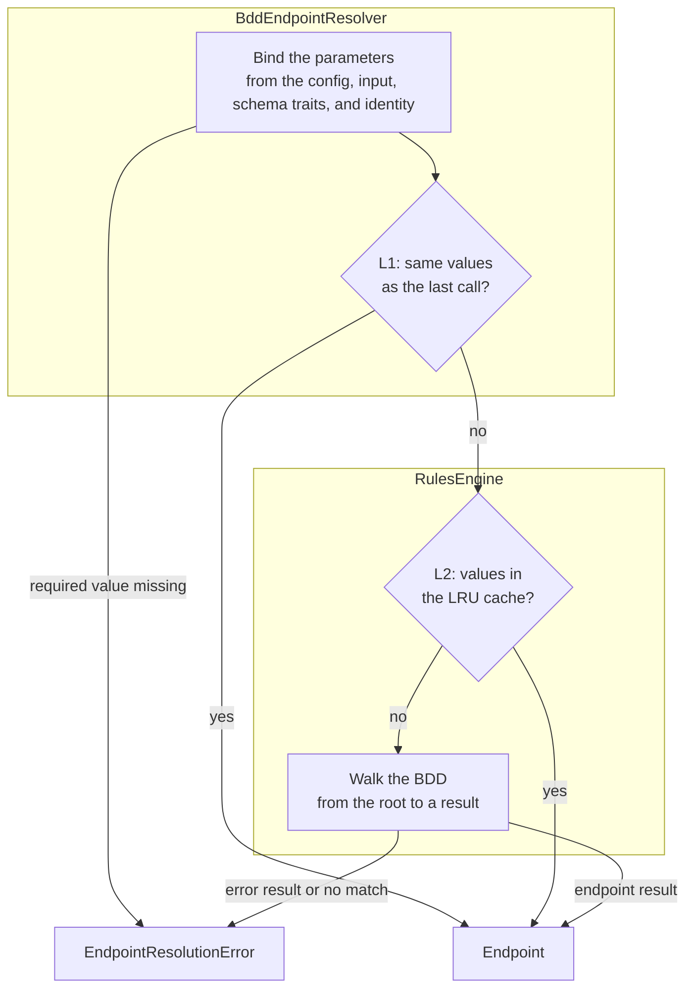
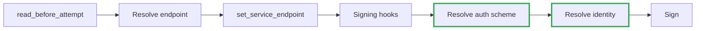
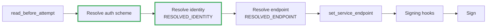

# Endpoint Resolution

## Summary

This document describes how smithy-python clients resolve endpoints from each
service's endpoint rules, which replace the fixed regional endpoint that AWS
clients build today. Each model carries these rules in its
`smithy.rules#endpointBdd` trait, and code generation lowers that trait into a
`BDD` constant of plain data in the generated client package. One rules engine
in `smithy-core` evaluates that data for every service, and `smithy-aws-core`
adds the AWS rules functions, built-in parameters, and partition data. On the
endpoint benchmark in the appendix, an uncached S3 resolution takes 10.3 µs, and
boto3, which evaluates rule-set trees, takes 131 µs.

## Motivation

Today, generated AWS clients use `AsyncStandardRegionalEndpointsResolver`, which
builds `<prefix>.<region>.amazonaws.com` and ignores the service's rules. That
host is wrong in partitions with other DNS suffixes, such as China and the ISO
Regions. Clients also can't bind some parameters the rules need yet: the config
has no FIPS or dual-stack fields, and the identity's account ID, which
DynamoDB's account-based endpoints read, resolves after the endpoint. Generic
clients default to `StaticEndpointResolver`, which only forwards
`endpoint_uri`. Code generation already embeds the raw `endpointBdd` trait in
every service schema, but nothing reads it yet.

Endpoint rules are the only complete description of a service's endpoints, and
every AWS model has them. Resolution runs on every attempt, and a workload that
addresses many buckets misses the cache often, so misses have to be fast. The
planned dynamic clients load models at runtime, so the engine can't depend on
per-service generated code.

## Goals

- Each generated client gets its rules as data, one `BDD` constant with no
  generated logic. A dynamic client can build the same data at runtime, so both
  use the same engine.
- One shared resolver in `smithy-core` resolves the endpoint from the BDD data
  lowered from each service's `endpointBdd` trait.
- Endpoint parameters come from schema traits and config, with no per-operation
  generated code.

This design doesn't evaluate `endpointRuleSet` decision trees. Specific
implementation details are out of scope to keep the document concise.

## Background

### Endpoint Rules

A service's endpoint rules, written in Smithy's rules language, compute an
endpoint from a few named **parameters**, such as `Region`, `UseFIPS`, or S3's
`Bucket`. The rules test **conditions**, each a call to a rules function such as
`isSet(Region)` or `stringEquals(Region, "aws-global")`, and end at a
**result**: an endpoint URL with optional properties and headers, or an error
message. A condition can also assign its value to a name that later conditions
and results read. For example, `PartitionResult = aws.partition(Region)` looks
up the Region's partition, which gives its DNS suffix and whether it supports
FIPS and dual-stack.

Parameters get their values from the client and from the operation:

- **Built-ins** are settings that every SDK supplies, such as `AWS::Region` from
  the `region` config field.
- **Client context parameters** are config settings that a service declares for
  its own client, such as S3's `ForcePathStyle`.
- **Context parameters** come from the operation: an input member marked
  `@contextParam`, such as S3's `Bucket`, a path into the input structure
  (`operationContextParams`), or a fixed value on the operation
  (`staticContextParams`).

### Rule Sets and BDDs

A model carries its rules in one of two traits. `endpointRuleSet` is a tree of
rules. A resolution tries them in order and takes the first whose conditions all
hold, so it can evaluate the same condition once for every rule that lists it.
boto3 evaluates these trees. `endpointBdd` holds the same parameters,
conditions, and results, arranged as a binary decision diagram (BDD). Smithy
compiles a rule set into a BDD, so all AWS services already provide the BDD
trait.

A BDD is a graph of decisions. Each node tests one condition and has two
branches: one to take when the condition holds, and one when it doesn't. Every
path ends at a result. A resolution starts at the root and takes one branch per
node, so it evaluates only the conditions on its path, each at most once. Paths
that lead to the same decisions share nodes, so the graph stays small: S3's
rules have 75 conditions, 115 results, and 553 nodes. Here is a simplified BDD
for a regional service, without dual-stack:



## Proposed State

### Overview

Code generation turns the trait into data in the client package, and the shared
runtime packages do the rest. The `BDD` constant replaces the raw trait that
generated schemas embed today, so `_private/schemas.py` no longer carries it.
Green marks new components, and red marks removed ones:



Each part owns one concern:

| Part                     | Owns                                                                                                                                                          |
| ------------------------ | ------------------------------------------------------------------------------------------------------------------------------------------------------------- |
| Code generation          | Lowering the `endpointBdd` trait into the `BDD` constant, the endpoint config fields, and the default resolver                                                |
| Generated client package | The `BDD` constant, the endpoint config fields, and the schema traits that the resolver reads. No endpoint logic                                              |
| `smithy-core`            | The resolver, the rules engine and its standard library, parameter binding, the extension API, the BDD format, and the request pipeline. Nothing AWS-specific |
| `smithy-aws-core`        | `AWS_RULES_EXTENSION`, with the `aws.*` functions, the AWS built-in bindings, and the partition data                                                          |

These are the new public names. Everything else is private:

| Name                                                                             | Module                                            | Purpose                                                                                       |
| -------------------------------------------------------------------------------- | ------------------------------------------------- | --------------------------------------------------------------------------------------------- |
| `BddEndpointResolver`                                                            | `smithy_core.endpoints`                           | The resolver that generated config constructs, for sync and async clients                     |
| `EndpointBdd`                                                                    | `smithy_core.endpoints`                           | The BDD data that generated modules hold and the resolver takes                               |
| `RulesExtension`, `BuiltinBinding`, `BuiltinGetter`, `EndpointAuthSchemeFactory` | `smithy_core.endpoints`                           | Add rules functions, built-in bindings, and auth schemes                                      |
| `Endpoint.auth_schemes`, `EndpointAuthScheme`, `ENDPOINT_HEADERS`                | `smithy_core.endpoints`, `smithy_core.interfaces` | An endpoint's auth schemes, and the endpoint property for the headers the rules add           |
| `UnsupportedAuthSchemeError`                                                     | `smithy_core.exceptions`                          | Raised when an endpoint lists auth schemes but not the one signing the request                |
| `RESOLVED_ENDPOINT`                                                              | `smithy_core.endpoints`                           | The endpoint resolved for the current attempt (context property)                              |
| `ENDPOINT_PARAMETERS`                                                            | `smithy_core.endpoints`                           | Endpoint parameter values that override the bound ones (context property)                     |
| `RESOLVED_IDENTITY`                                                              | `smithy_core.auth`                                | The identity resolved for the current attempt (context property)                              |
| `ContextParamTrait`, `OperationContextParamsTrait`, `StaticContextParamsTrait`   | `smithy_core.traits`                              | The context parameter traits in generated schemas                                             |
| `AWS_RULES_EXTENSION`                                                            | `smithy_aws_core.endpoints`                       | The AWS rules functions, built-ins, and partition data                                        |

Resolution never awaits, so the engine, `ParamPlan`, and the rules libraries are
sync code under `smithy_core.endpoints` and `smithy_aws_core.endpoints`. This
design defines the sync `EndpointResolver` protocol in `smithy_core.interfaces`,
which is a placeholder today. `BddEndpointResolver` implements it and holds the
resolution logic, and sync and async clients both call it.

### What a Generated Client Gets

A generated client gets data and config, and no endpoint logic:

- `_private/endpoints.py`, a new module with one constant, `BDD`.
- A new default `endpoint_resolver` in `config.py`.
- A config field for each client context parameter, and `use_fips_endpoint`,
  `use_dualstack_endpoint`, and `account_id_endpoint_mode` when the rules
  declare their built-ins (see [Config Fields](#config-fields)).
- Schemas that keep the three context parameter traits, which the resolver reads
  at runtime. They no longer embed the raw `endpointBdd` trait.

AWS clients pass the AWS extension to the default resolver, and other clients
construct `BddEndpointResolver(BDD)` with no extensions:

```python
"endpoint_resolver": FieldSpec(
    default_factory=lambda: BddEndpointResolver(
        BDD, extensions=[AWS_RULES_EXTENSION]
    )
),
```

Here is the generated data, trimmed:

```python
"""Endpoint BDD for aws.protocoltests.json10#JsonRpc10."""

from smithy_core.endpoints import EndpointBdd

# Tags: ref=0, attr=1, call=2, list=3, map=4, error=5, endpoint=6.
BDD = EndpointBdd(
    # (name, type, required, default, builtin, client_context_attribute)
    parameters=(
        ("Region", "string", False, None, "AWS::Region", None),
        ("UseDualStack", "boolean", True, False, "AWS::UseDualStack", None),
        ("UseFIPS", "boolean", True, False, "AWS::UseFIPS", None),
        ("Endpoint", "string", False, None, "SDK::Endpoint", None),
    ),
    functions=("aws.partition", "booleanEquals", "isSet", "stringEquals"),
    conditions=(
        ((2, "isSet", (0, "Endpoint")), None),  # 0: isSet(Endpoint)
        ((2, "isSet", (0, "Region")), None),  # 1: isSet(Region)
        ((2, "aws.partition", (0, "Region")), "PartitionResult"),  # 2: PartitionResult = aws.partition(Region)
        ...
    ),
    results=(
        None,  # 0: no match
        (5, "Invalid Configuration: FIPS and custom endpoint are not supported"),  # 1
        ...
        (6, "https://jsonrpc10.{Region}.{PartitionResult#dnsSuffix}", None, ()),  # 11
        (5, "Invalid Configuration: Missing Region"),  # 12
    ),
    root=2,
    nodes=(...),
)
```

`EndpointBdd` is a public `NamedTuple` in `smithy_core.endpoints`. Its fields
hold the trait's data: the parameters, the functions the rules call, the
conditions, the results, the root, and the nodes, three integers per node for
its condition and its two branches. Expressions and results are tuples that
start with a small integer tag, listed in the module's first comment; integer
tags load about 4% faster than string tags for S3 and keep the BDD one
compile-time constant. Entries keep the trait's names and Smithy's template
strings, so a reviewer can match each one to the trait. The BDD makes no
decisions for the engine, so engine changes don't change generated output.

Code generation validates the trait and accepts version 1.1 only.

**Alternatives Considered:**

- Generate a resolver for each service, as smithy-rs and smithy-go do. This was
  not chosen because the generated output would no longer be data, dynamic
  clients couldn't use it, and every engine change would change every generated
  client.

### Dynamic Clients

Dynamic clients are planned. A dynamic client loads a model at runtime instead
of a generated package, and uses the same runtime pieces as a generated client:

- A Python lowering turns the model's `endpointBdd` trait into the same
  `EndpointBdd` that code generation writes (see
  [Follow-Up Work](#follow-up-work)).
- The client builds
  `BddEndpointResolver(bdd, extensions=[AWS_RULES_EXTENSION])` and keeps it
  with the loaded model.
- Parameter binding reads the same context parameter traits from the runtime
  schemas, and reads input members by the same Python names that dynamic models
  use.
- Its config exposes client context parameters and built-ins under the same
  attribute names as generated config.

### Package Layout

These are the main new and changed files, with a generated protocol test client
as the example client:

```text
packages/smithy-core/src/smithy_core/
├── __init__.py                 # URI host fast path
├── _jmespath.py                # NEW: Compiles operationContextParams paths
├── auth.py                     # RESOLVED_IDENTITY
├── traits.py                   # The three context parameter traits
├── interfaces/__init__.py      # Defines the sync EndpointResolver protocol
├── _pipeline.py                # Resolves the identity before the endpoint
└── endpoints/                  # NEW: replaces endpoints.py
    ├── __init__.py             # Re-exports BddEndpointResolver, EndpointBdd, RulesExtension
    ├── _engine.py              # RulesEngine
    ├── _params.py              # ParamPlan
    ├── _resolver.py            # BddEndpointResolver
    ├── _standard_library.py    # The standard functions the engine calls
    └── _types.py               # EndpointAuthScheme, EndpointBdd, RulesExtension, property keys

packages/smithy-aws-core/src/smithy_aws_core/
└── endpoints/
    ├── __init__.py
    ├── _aws_library.py         # NEW: Defines AWS_RULES_EXTENSION
    └── partitions.json         # NEW: The AWS SDK partition data

codegen/
├── core/.../generators/
│   ├── EndpointBddGenerator.java              # NEW: Lowers the trait into tuple format
│   └── ConfigGenerator.java                   # Set default resolver, add client context param fields
└── aws/core/.../
    ├── AwsEndpointRulesIntegration.java       # NEW: Replaces AwsStandardRegionalEndpointsIntegration
    ├── AwsAsyncConfigIntegration.java         # Set default resolver, AWS-specific endpoint fields
    └── customizations/s3/S3EndpointConfigIntegration.java  # NEW: S3 and S3 Control client context fields

codegen-output/aws-json-1-0/src/awsjson10/
├── _private/endpoints.py       # NEW: The EndpointBdd tuple
└── config.py                   # Default endpoint_resolver
```

### Resolving an Endpoint

Each client config builds one resolver, and the resolver builds its own engine.
On every attempt, the resolver binds the parameters and checks L1. On a miss,
the engine checks L2 and walks the BDD:



### Endpoint Parameters

The resolver builds one `ParamPlan` from the BDD's parameters and the
extensions' bindings, and the plan reads each operation's schema traits on that
operation's first call. On every call, `bind` reads the config, the input, and
the call context and returns the cache key, so per-call config overrides apply.
Sources take precedence in this order, highest first; after the first, it is the
order Smithy's rules engine specification gives:

1. `ENDPOINT_PARAMETERS` in the call context, which overrides every other source
2. `staticContextParams` on the operation
3. `contextParam` on top-level input members
4. `operationContextParams` on the operation
5. `clientContextParams`
6. built-ins
7. the parameter's default

Before the caches, the plan raises `EndpointResolutionError` when a required
parameter has no value.

A client context parameter reads the config field the BDD defines for it, and so
does a built-in that is also a client context parameter, such as S3's
`ForcePathStyle`. Code generation picks that field (see
[Config Fields](#config-fields)), so the runtime never derives a field name. Any
other built-in reads what its extension binds, and a built-in that no extension
binds takes its default. `operationContextParams` paths compile once with a
private compiler for the JMESPath subset those paths allow, which reads
structures, lists and maps without converting them. In the AWS models, only five
DynamoDB operations use these paths.

The AWS extension binds these built-ins:

| Built-in                                                    | Binding                                                                    |
| ----------------------------------------------------------- | -------------------------------------------------------------------------- |
| `AWS::Region`                                               | `region`                                                                   |
| `AWS::UseFIPS`                                              | `use_fips_endpoint`                                                        |
| `AWS::UseDualStack`                                         | `use_dualstack_endpoint`                                                   |
| `AWS::Auth::AccountIdEndpointMode`                          | `account_id_endpoint_mode`                                                 |
| `AWS::Auth::AccountId`                                      | `account_id` of the identity under `RESOLVED_IDENTITY`                     |
| Other `AWS::S3::*` and `AWS::S3Control::*`                  | not bound: each is also a client context parameter, so it reads that field |
| `AWS::S3::UseGlobalEndpoint`, `AWS::STS::UseGlobalEndpoint` | not bound                                                                  |

The two unbound built-ins select legacy global endpoints. The AWS SDKs and Tools
Reference Guide says new SDK major versions released after July 2022 default to
regional STS endpoints, and Java 2.x, JavaScript 3.x, Go v2, Kotlin, Rust, and
Swift don't support the setting. The S3 setting isn't a standardized SDK
setting. Both keep their default, so the rules return regional endpoints.

**Alternatives Considered:**

- Use the `jmespath` package for `operationContextParams`. This was not chosen
  because it evaluates only dicts and lists, so the plan would convert each
  input first, at a cost that grows with the input. It would also add a
  dependency to `smithy-core`. The new `_jmespath.py` module can be reused for
  our future waiter support and is lazily loaded, so most evaluations don't load
  it.

### Caching

The resolver holds L1, and its engine holds L2. L1 is the last parameter values
and their endpoint, stored as one tuple, so a reader sees a matching pair
without taking a lock. L2 is a 128-entry `functools.lru_cache` around the
engine's walk. Both are keyed by the tuple of parameter values, which holds only
the parameters the rules read. A hit skips the walk but still binds the
parameters.

Calls share cached endpoints, so callers must treat them as read-only. `URI` is
frozen and every value the rules produce is immutable, but `Endpoint` and its
`properties` are not, so callers must not change them.

### Evaluating the BDD

`RulesEngine`, private to `smithy-core`, evaluates one BDD. At construction it
raises one error that names every function the BDD lists that neither the engine
nor an extension provides. A walk starts at the root, evaluates each node's
condition to choose a branch, and stops at a result.

The engine compiles each condition and result into a closure: a Python function
that keeps the values it was built with. botocore uses the same technique for
its clients. It builds each client class from the service model at runtime, and
each operation method is a closure that captures its operation name. Here, a
closure captures what the engine reads from a condition's tuple, so that reading
happens once instead of on every call. For example, condition 7 of the JSON RPC
1.0 BDD:

```python
# The condition, as the generated module stores it:
((2, "stringEquals", (1, (0, "PartitionResult"), "name"), "aws-us-gov"), None)

# The closure it compiles to, simplified. `values` holds the bound parameter values in
# BDD order (Region, UseDualStack, UseFIPS, Endpoint), then one slot per name that a
# condition assigns, so slot 4 is PartitionResult.
def condition(values):
    return values[4]["name"] == "aws-us-gov"
```

An interpreter would match the tags, look up `stringEquals`, and find
`PartitionResult` on every call. The closure does that once, and each later call
indexes a list and compares two strings. The engine compiles each entry the
first time a walk reaches it and reuses the closure after that, so a process
pays only for the rules its traffic reaches: each S3 case in the appendix
reaches 15 to 31 of S3's 75 conditions.

An endpoint result becomes an `Endpoint` with the rendered URI. The rules'
headers go under `ENDPOINT_HEADERS`, `authSchemes` becomes `auth_schemes` (see
[Endpoint Auth Schemes](#endpoint-auth-schemes)), and every other property keeps
its rules name, with lists as tuples and maps as read-only mappings. An error
result or no match raises `EndpointResolutionError`, and the engine wraps any
other exception from a walk in one.

**Alternatives Considered:**

These numbers come from a study that ran each approach over the same S3 and SQS
cases with caches off.

- **Interpret the BDD's tuples on every call, as botocore does with its rule-set
  trees.** This was not chosen because an interpreter was about 60% slower than
  closures on an S3 miss.
- **Lower the BDD to bytecode for a stack VM, as smithy-php does.** This was not
  chosen because a Python VM was about 45% slower than closures. smithy-php's VM
  is fast because PHP's opcache compiles its opcode `switch` into a jump table
  and its tracing JIT compiles the hot loop. CPython has neither by default, so
  it compares opcodes one by one, and about half of the instructions load
  operands that a closure already holds. The generated module would also hold
  the bytecode as an opaque `bytes` constant.
- **Evaluate the BDD in a Rust extension.** This was not chosen because about
  40% faster S3 misses don't justify a native extension and a pure-Python
  fallback to maintain. Most of the cost is building Python objects, which Rust
  can't avoid without depending on smithy-core's class layouts. The BDD doesn't
  depend on the engine, so a native engine can still come later behind the same
  resolver.

### Extensions

Rules functions, built-in bindings, and auth schemes come from extensions.
`RulesExtension`, `BuiltinBinding`, `BuiltinGetter` and
`EndpointAuthSchemeFactory` are public, in `smithy_core.endpoints`:

```python
type BuiltinGetter = Callable[[Any, TypedProperties], Any]
type BuiltinBinding = str | BuiltinGetter
type EndpointAuthSchemeFactory = Callable[[Mapping[str, Any]], EndpointAuthScheme]


@dataclass(frozen=True, slots=True)
class RulesExtension:
    functions: Mapping[str, Callable[..., Any]]
    """Rules functions by rules-language name. Their result must depend only on their
    arguments, with no side effects, because resolved endpoints are cached by
    parameter values. Given None for an unset value, they return None."""

    builtins: Mapping[str, BuiltinBinding]
    """Built-in IDs mapped to a config attribute name, or to a getter that receives
    the config and the call context."""

    auth_schemes: Mapping[str, EndpointAuthSchemeFactory]
    """Auth scheme names, as endpoint rules write them in ``authSchemes``, mapped to
    factories that build the endpoint's auth scheme from the rules' entry."""
```

The rules standard library is part of the engine, not an extension. The engine
compiles `isSet`, `not`, `booleanEquals`, `stringEquals`, `coalesce`, and `ite`
into closures and calls the other standard functions, and parameter binding
provides the `SDK::Endpoint` built-in, which reads `endpoint_uri`. Their names
are reserved: a resolver raises when an extension redefines a standard function
or binds `SDK::Endpoint`. `smithy_aws_core.endpoints.AWS_RULES_EXTENSION` adds
`aws.partition`, `aws.parseArn`, `aws.isVirtualHostableS3Bucket`, the AWS
built-ins, and the AWS auth schemes: `sigv4`, `sigv4a` and `sigv4-s3express`.
Generated config passes extensions to the resolver explicitly, and the resolver
gives their functions to the engine and their built-ins to parameter binding.

The AWS partition data is `partitions.json`, the partitions file that every AWS
SDK ships, kept exactly as published. The release pipeline is to replace the
file when the published file changes, as the JavaScript and Go SDKs do, and the
smithy-aws-core release that carries it bumps every client. `aws.partition`
memoizes its result per Region.

**Alternatives Considered:**

- Keep the standard library as an extension that is always included first, so
  other extensions can override its functions and built-ins. This was not chosen
  because the engine compiles six of those functions itself, so overriding them
  would silently do nothing, and overriding the others would change standard
  semantics that every service's rules rely on.

### Config Fields

Code generation adds these fields for the bindings to read:

- `use_fips_endpoint` and `use_dualstack_endpoint`, when the rules declare
  `AWS::UseFIPS` and `AWS::UseDualStack`. Of the 436 services, 433 declare the
  FIPS built-in and 385 the dual-stack one.
- `account_id_endpoint_mode`, when the rules declare
  `AWS::Auth::AccountIdEndpointMode`, as three services do. Its values are
  `preferred`, `disabled`, or `required`, and it defaults to `preferred`.
- One field per `clientContextParams` entry, named in snake case and typed and
  documented from the trait. S3 names its `Accelerate` field
  `use_accelerate_endpoint`, as botocore does.

Apart from `account_id_endpoint_mode`, an unset field reads `None`, so the
rule's default applies.

The fields below also resolve from the environment and the shared config file,
and the built-in ones follow the AWS SDKs and Tools Reference Guide:

| Field                                | Environment variable                       | Shared config key                      |
| ------------------------------------ | ------------------------------------------ | -------------------------------------- |
| `use_fips_endpoint`                  | `AWS_USE_FIPS_ENDPOINT`                    | `use_fips_endpoint`                    |
| `use_dualstack_endpoint`             | `AWS_USE_DUALSTACK_ENDPOINT`               | `use_dualstack_endpoint`               |
| `account_id_endpoint_mode`           | `AWS_ACCOUNT_ID_ENDPOINT_MODE`             | `account_id_endpoint_mode`             |
| `use_arn_region`                     | `AWS_S3_USE_ARN_REGION`                    | `s3_use_arn_region`                    |
| `disable_multi_region_access_points` | `AWS_S3_DISABLE_MULTIREGION_ACCESS_POINTS` | `s3_disable_multiregion_access_points` |
| `disable_s3_express_session_auth`    | `AWS_S3_DISABLE_EXPRESS_SESSION_AUTH`      | `s3_disable_express_session_auth`      |

Values are case-insensitive, and an unknown value raises. Other client context
fields are set in code only.

### Request Pipeline

The shared request pipeline now resolves the auth scheme and the identity
before the endpoint. Green marks the steps that move. Today, they resolve after
the endpoint, just before signing:



With this design, they resolve first, so the endpoint rules can read the
identity:



The `AWS::Auth::AccountId` getter reads the identity under `RESOLVED_IDENTITY`,
so DynamoDB can resolve account-based endpoints. smithy-rs and smithy-java use
the same order. Interceptors see the auth scheme and identity resolve after
`read_before_attempt` instead of after `read_before_signing`, and identity
errors surface before endpoint errors.

`set_service_endpoint` merges the endpoint's URI into the request. It doesn't
apply `ENDPOINT_HEADERS` yet, and in the AWS models only S3 Control's rules add
headers. Setting `endpoint_uri` supplies `SDK::Endpoint`, so the rules apply
their custom-endpoint behavior, such as rejecting FIPS with a custom endpoint.
Setting `endpoint_resolver=StaticEndpointResolver()` bypasses the rules.

### Endpoint Auth Schemes

Endpoint rules can attach `authSchemes` to an endpoint, as every S3 endpoint
does. Each entry names an auth scheme and gives signing settings for that
endpoint, such as the signing Region. As the Smithy client guidance for
endpoints recommends, the resolved `Endpoint` carries them in `auth_schemes` as
`EndpointAuthScheme(scheme_id, properties)` entries, in the rules' order. An
extension's factory builds each entry, and turns the rules' settings into signer
property overrides: for example, a `sigv4` entry's `signingRegion` becomes the
SigV4 signer's `region`. Entries whose names no extension maps are dropped, and
if none is mapped, resolution raises `EndpointResolutionError`. An empty
`auth_schemes` means the endpoint has no special auth settings.

The service's auth traits choose the scheme, and the endpoint only changes how
it signs. The signer properties are the scheme's defaults, then the auth
option's overrides, then the endpoint's overrides for the selected scheme, and
later values win. For example, STS's `aws-global` Region signs for `us-east-1`
instead of `config.region`.

When the endpoint lists auth schemes but not the resolved scheme, the request
fails before signing with `UnsupportedAuthSchemeError`. In the AWS models, only
some S3, SES v2, EventBridge, and CloudFront KeyValueStore endpoints do this,
because they need SigV4a or S3 Express (see [Follow-Up Work](#follow-up-work)).

### Faster URI Construction

`URI.__post_init__` ran the full RFC 3986 host regular expression on every
construction. `set_service_endpoint` builds a `URI` on every attempt, and the
engine builds one on every cache miss. `__post_init__` now accepts a host made
only of the unreserved characters `[A-Za-z0-9._~-]` without the full expression,
and checks every other host as before. Every such host is a valid registered
name, so the set of accepted hosts doesn't change. In a local measurement,
construction takes about 60% less time on CPython 3.12 and 3.14.

### Testing

Testing has two layers:

- **Component tests.** Each part has its own suite: the Java lowering and its
  validation, the rules engine and standard library, parameter binding, the AWS
  rules functions, and the resolver.
- **Generated client tests.** Code generation turns each model's `endpointTests`
  into tests in the generated client, so every client checks its own endpoints
  against the model's cases when its tests run. The tests pass the client's
  rules extensions to the checks, which build the auth schemes a case expects
  with the extensions' factories.

## Follow-Up Work

- Applying rule headers in `set_service_endpoint`, which S3 Control needs.
- The endpoint trait's `hostPrefix` and the `disable_host_prefix_injection`
  setting. Today `set_service_endpoint` replaces the host the REST serializers
  build, which drops the prefix.
- A Python lowering for dynamic clients and Python code generation.
- Legacy endpoint-driven auth resolution for S3, SES v2, EventBridge, and
  CloudFront KeyValueStore. This is required once smithy-python supports SigV4a
  or S3 Express. AWS SDKs keep this behavior for these four services only.

## Appendix: Performance

The benchmark times 1,000 resolutions after 100 warmup calls, with the same
input on every call and the SDK's caches off. Here it times the resolver's
`resolve_endpoint`, so each call binds the config and input and walks the BDD,
with the operation's plan already built. These ran on CPython 3.14.10, in three
rounds, and each value is the fastest round's mean, because interference slowed
single rounds on the m7i host by up to 60%. boto3's numbers come from an earlier
run of the same benchmark, with botocore 1.43.108 on CPython 3.14.8. Both ran on
m7i.xlarge and m7g.xlarge in us-east-1. The hit columns time the same calls with
the caches on, after a first warmup call that misses and fills them. For L1
hits, every timed call finds its values in L1. For L2 hits, L1 is cleared before
each call, outside the timed region, so every timed call misses L1 and finds its
endpoint in L2. The hit columns come from a later run of the same engine on new
instances. The resolver in this benchmark was **partially optimized**; more
improvements are still possible.

Mean time per call, in µs:

| Case                                           | m7i, v4 miss | m7i, boto3 miss | m7g, v4 miss | m7g, boto3 miss | m7i, v4 L1 hit | m7i, v4 L2 hit | m7g, v4 L1 hit | m7g, v4 L2 hit |
| ---------------------------------------------- | ------------ | --------------- | ------------ | --------------- | -------------- | -------------- | -------------- | -------------- |
| S3 virtual addressing                          | 10.3         | 131             | 12.5         | 181             | 1.09           | 1.21           | 1.84           | 1.99           |
| S3 path style                                  | 10.9         | 108             | 13.2         | 144             | 1.06           | 1.21           | 1.85           | 2.01           |
| S3 Express, short zone name                    | 11.8         | 65.7            | 14.2         | 83.0            | 1.06           | 1.20           | 1.83           | 1.96           |
| S3 access point ARN                            | 18.1         | 130             | 22.1         | 169             | 1.06           | 1.14           | 1.83           | 1.95           |
| S3 Outposts                                    | 22.6         | 121             | 26.4         | 154             | 1.08           | 1.21           | 1.86           | 1.97           |
| Lambda, us-east-1                              | 4.6          | 18.4            | 5.6          | 25.1            | 0.88           | 0.94           | 1.42           | 1.56           |
| Lambda, us-gov-east-1 with FIPS and dual-stack | 5.0          | 27.1            | 6.2          | 37.7            | 0.82           | 0.92           | 1.43           | 1.56           |
