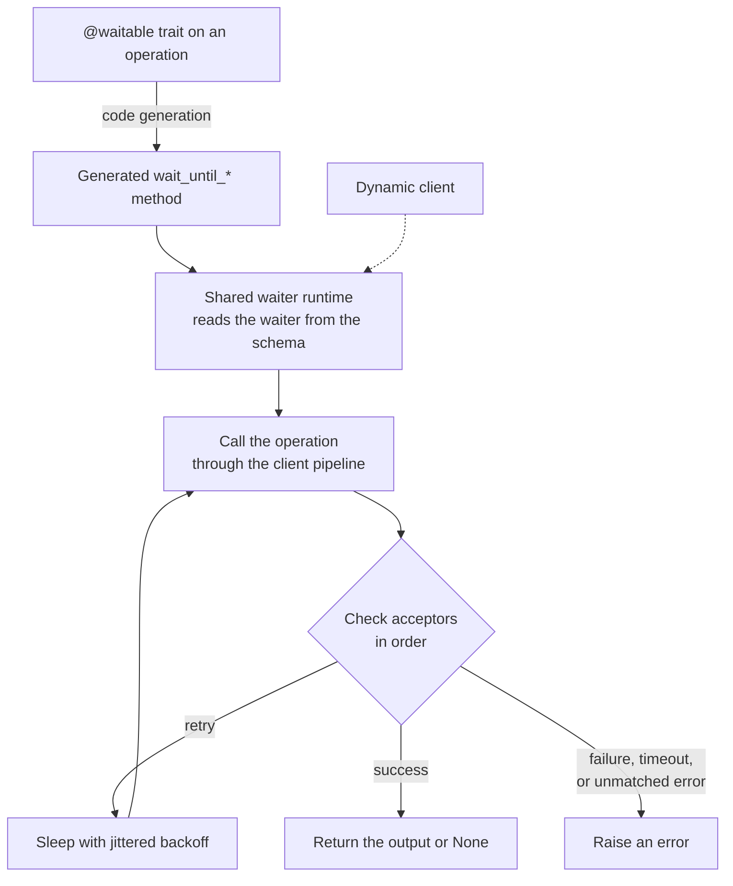

# Waiters

## Summary

This document proposes generating a `wait_until_<waiter>` method for each waiter
defined with Smithy's `@waitable` trait. Each method polls an operation until an
acceptor reports success or failure, or until the caller's time limit passes.
The waiter definitions stay in the operation schemas. One shared runtime
evaluates them for synchronous, asynchronous, and dynamic clients.

## Motivation

Many resources take time to reach a usable state after they are created,
changed, or deleted. Customers currently need to write the polling loop
themselves. Each loop must classify responses and errors, choose delays, and
stop at a deadline. For example, waiting for a new DynamoDB table to become
active requires:

```python
deadline = time.monotonic() + 300
while True:
    try:
        response = await client.describe_table(table_name="orders")
    except ResourceNotFoundException:
        pass
    else:
        if response.table and response.table.table_status == "ACTIVE":
            break
    if time.monotonic() >= deadline:
        raise TimeoutError("The orders table did not become active.")
    await asyncio.sleep(20)
```

The model already describes the states to wait for and the delays between
attempts. Client waiter methods remove this repeated code and give every waiter
the same timing and error behavior.

## Proposal

### Architecture

Each waiter method is a thin wrapper that hands its operation and waiter name to
a shared runtime in `smithy-core`. The runtime reads the acceptors and delays
from the operation's schema, then polls until it can return or raise:



Since the definitions are data, a dynamic client can use the same runtime to
wait on any modeled waiter.

### Waiting

Each waiter gets a method named `wait_until_` followed by the snake_case waiter
name, on both the synchronous and asynchronous clients. It accepts the same
input parameters and per-call plugins as the operation it polls. It also
requires the maximum number of seconds to wait:

```python
# Synchronous client
client.wait_until_table_exists(table_name="orders", max_wait_time=300)

# Asynchronous client
await client.wait_until_table_exists(table_name="orders", max_wait_time=300)
```

Synchronous methods block between attempts. Asynchronous methods yield to the
event loop while they sleep.

Requests run through the normal client pipeline, so authentication, retries,
interceptors, and plugins apply to each attempt. The client's retry strategy
handles throttling and transient errors within an attempt. Only the attempt's
final result reaches the acceptors.

Every waiter method returns the operation's output or `None`. On success, it
returns the output that matched. Waiters that succeed on an error, such as
`TableNotExists` on `ResourceNotFoundException`, return `None`. The return type
(`Output | None`) doesn't depend on the waiter's acceptors, so a model update
that changes them can't modify the return type.

```python
output = await ec2.wait_until_instance_running(
    instance_ids=[instance_id], max_wait_time=600
)
if output is not None:
    for reservation in output.reservations or []:
        process(reservation)
```

### Wait time and delays

`max_wait_time` has no default. The Smithy specification requires callers to
choose it, so no waiter can run for an unbounded time. The limit covers both
request time and delays.

Delays between attempts use the specification's exponential backoff with full
jitter. They start at the waiter's `minDelay` and grow toward its `maxDelay`,
which default to 2 and 120 seconds. Customers can replace either bound for a
call:

```python
await client.wait_until_table_exists(
    table_name="orders", max_wait_time=600, min_delay=5, max_delay=30
)
```

All three values are seconds as floats. Invalid values, such as a `min_delay`
above `max_delay`, raise `ValueError` before any request is sent. Near the
limit, the waiter sleeps until the limit and makes one last attempt. That
attempt's response is still checked against the acceptors.

The waiter doesn't cancel a request in flight at the limit, because the
specification schedules the last attempt at that moment. Async callers that need
a hard limit can wrap the call in `asyncio.timeout()`.

`max_wait_time`, `min_delay`, and `max_delay` are reserved input member names on
waitable operations, in the same way as `plugins`. No AWS input uses them today.

The specification bounds waits by time and doesn't define attempt limits. This
proposal doesn't add one, because with jittered backoff an attempt count doesn't
map to a predictable wait.

### Failures

Waiters raise an exception for every outcome other than success. Both waiter
exceptions are in `smithy_core.exceptions` and inherit from `WaiterError`:

* `WaiterFailureError` means an acceptor moved the waiter to its failure state.
  For example, an EC2 instance terminated while the caller waited for it to run.
  When the acceptor has a `message` expression, the exception message includes
  its result.
* `WaiterTimeoutError` means the limit passed before any acceptor reported
  success or failure.

Both exceptions have three fields:

* `attempts` is the number of attempts made.
* `last_output` is the output the last attempt returned, or `None`.
* `last_error` is the error the last attempt raised, or `None`.

```python
try:
    await ec2.wait_until_instance_running(
        instance_ids=[instance_id], max_wait_time=600
    )
except WaiterFailureError as error:
    print(f"The instance failed to start after {error.attempts} attempts.")
```

An error that no acceptor matches ends the wait and propagates unchanged, as it
would from the operation. This includes permission and credential errors, such
as a 403. The waiter keeps polling through an error only when a retry acceptor
names it.

### Runtime

The runtime has three parts:

| Part | Component | Holds | Lives |
| --- | --- | --- | --- |
| Waiter definition | `WaiterDefinition` | A waiter's delays and ordered acceptors, built from the trait | For the process, cached on the operation's schema |
| Wait loop | `wait()` in `smithy_core.waiters`, `wait_async()` in `smithy_core.aio.waiters` | No state. It calls the operation and sleeps | For one waiter call |
| Waiter state | `WaiterState` | The deadline, the attempt count, and the last result | For one waiter call |

Generated clients keep the `smithy.waiters#waitable` trait in each operation's
schema. The first wait on an operation builds its waiter definitions from the
trait and caches them on the operation's schema with a `SchemaExtension`. Later
waits in the process reuse them. A dynamic client's schemas can use the same
cache.

Each waiter call runs one wait loop with its own waiter state. The loop calls
the operation and hands the result to the state. The state checks the acceptors,
applies the implicit transitions, and computes the backoff. It then tells the
loop to return, raise, or sleep before the next attempt. The sync and async
loops use the same waiter state. They differ only in how they call the operation
and how they sleep.

`WaiterDefinition` and `WaiterState` are private to `smithy_core._waiters`.
These can be exposed in the future if needed for user-defined waiters.

### Matchers

| Matcher | Matches when |
| --- | --- |
| `output` | The path, run against the output, satisfies the comparator. |
| `inputOutput` | The path, run against `{"input": request, "output": output}`, satisfies the comparator. |
| `success` | `true` matches an output. `false` matches an error. |
| `errorType` | The error's shape name or `response_metadata.error_code` equals the name. |

Paths read the model objects directly, using the model's member names such as
`Table.TableStatus`. `smithy_core._jmespath` compiles each path once, when the
waiter definition is built. Endpoint resolution already uses this module.
Waiters extend it with comparisons, filters, and `length()`. Values and
comparators follow the specification.

`errorType` also checks error codes because the specification lets it name
errors that aren't modeled. For example, EC2 models no errors, so its waiters
match codes such as `InvalidInstanceID.NotFound`. Some awsQuery waiters also use
a code that differs from the shape name, such as IAM's `NoSuchEntity` for
`NoSuchEntityException`.

### Alternatives considered

* **Look up waiters by name.** boto3 gets a waiter from a string, as in
  `client.get_waiter("table_exists").wait(...)`. Type checkers can't check the
  name, the input, or the result.
* **Return a waiter object.** smithy-java returns an object per waiter, as in
  `client.waiter().tableExists().wait(...)`. This adds a step before each wait.
* **Generate the matchers.** Go, Rust, TypeScript, and Kotlin generate each
  waiter's matchers as code. The definitions would then exist only in generated
  code, so dynamic clients couldn't wait.
